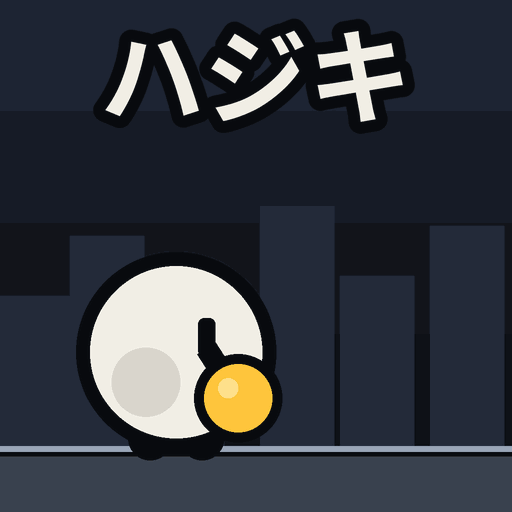
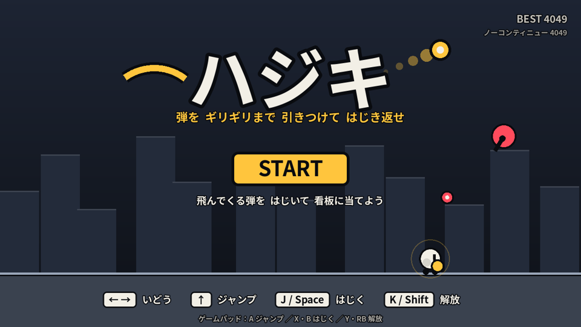
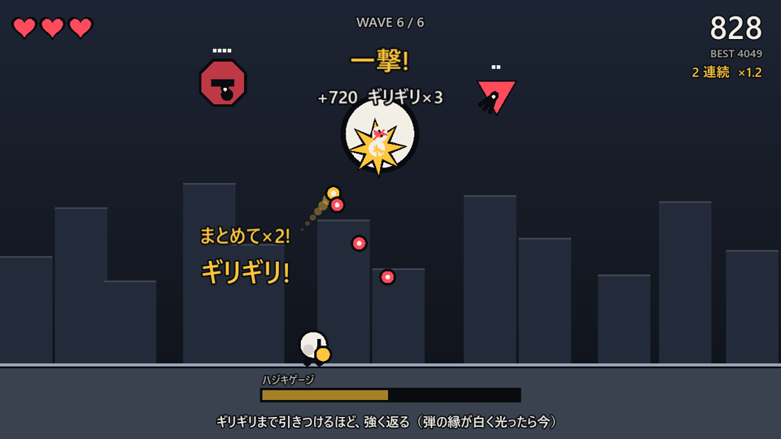
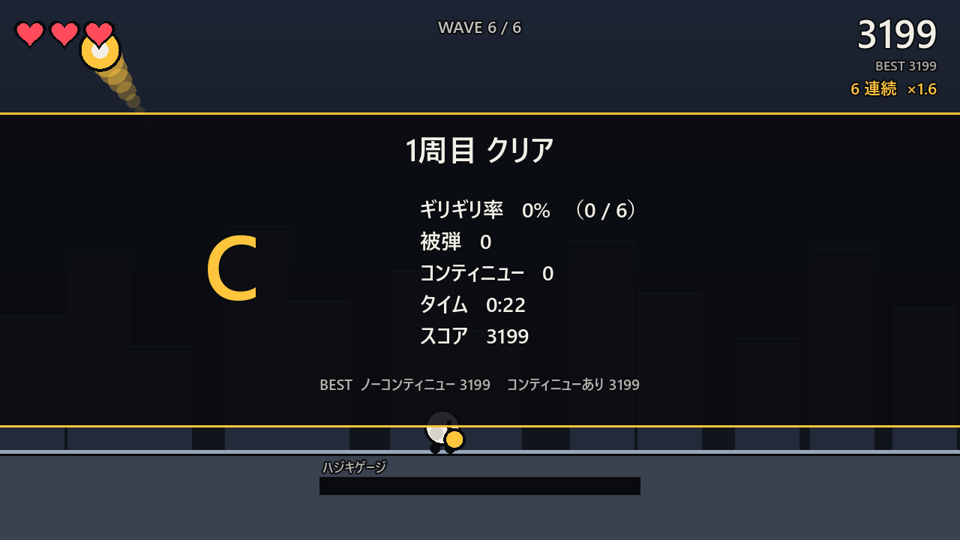
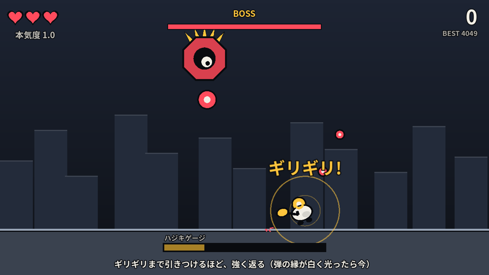
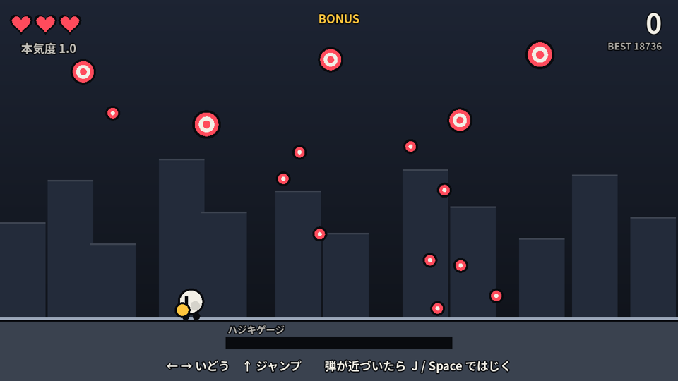
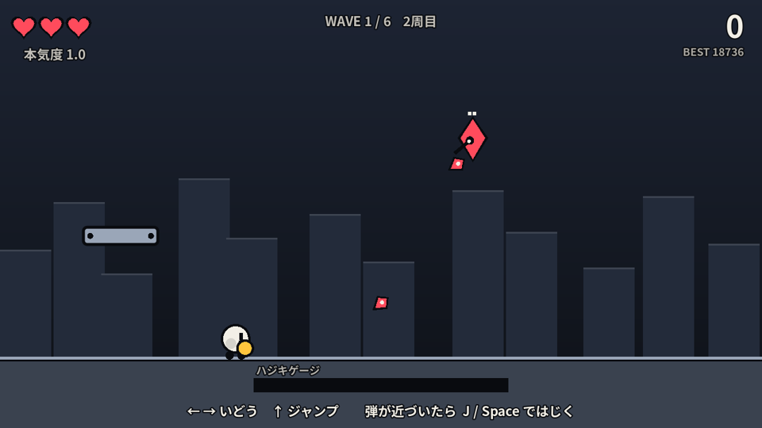
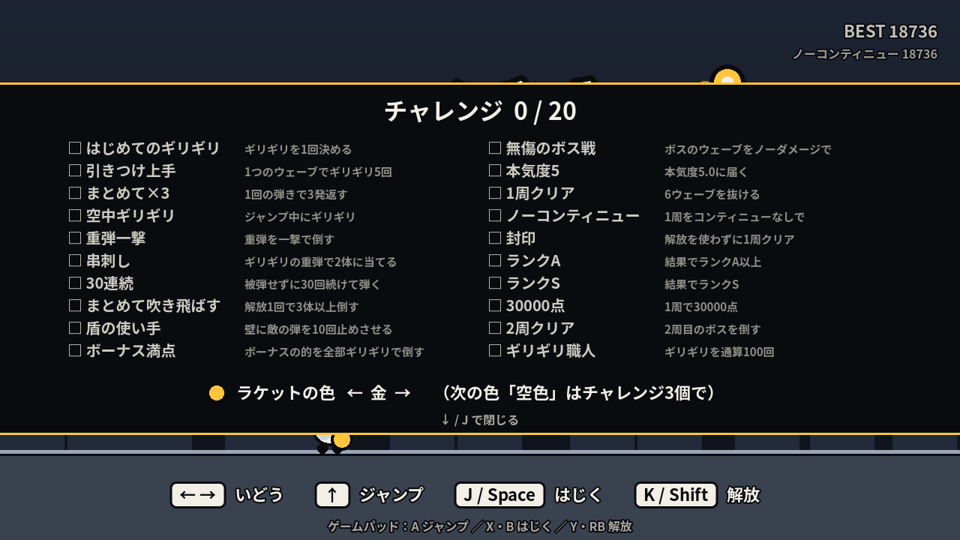

# 作例：ハジキ（Godot 4.6）

このリポジトリの `sakurai` スキルを読み込んだ AI エージェント（Claude Code）が、企画・実装・磨き込み・タイトル・アイコンまで作った一画面アクションの試作です。

- **遊ぶ**: [unityroom「ハジキ」](https://unityroom.com/games/hajiki)（ブラウザで遊べます）
- **エンジン**: Godot 4.6.3（GDScript 約2,000行・画像素材なし、図形と効果音はコードで生成）
- **作り方**: 人がしたのは「何を作るか」の指示と、遊んだ感想だけです。どの仕様も、スキルのどの原則に従ったかを動画番号で記録しています。

> 動画番号は「桜井政博のゲーム作るには」の通し番号（古い順の 001〜259）です。要点は `skills/sakurai/references/` の各ファイルにあります。非公式のファンメイドで、桜井政博氏・有限会社ソラとは関係ありません。

## どんなゲームか

敵の弾を**引きつけるほど強く打ち返せる**アクションです。早く弾けば安全ですが弱く、当たる寸前で弾けば大きな反撃になります。

| タイトル | プレイ中 | 結果画面 |
|---|---|---|
|  |  |  |

- 弾いた時の判定は3段（ギリギリ／ナイス／セーフ）で、威力は 3 / 2 / 1。
- 弾くとハジキゲージがたまり、満タンで解放すると画面中の弾をまとめて返します。
- 6ウェーブで1周。各周の最後はボス、その手前は稼げるボーナス。結果画面でランクを出し、2周目からは弾を止める「壁」や新しい敵が出ます。
- ノーダメージで抜けるほど上がる「本気度」と、20個のチャレンジ（達成数でラケットの色が増える）があります。

| ボス | ボーナス | 壁（2周目〜） | チャレンジ一覧 |
|---|---|---|---|
|  |  |  |  |

## 作った順番とスキルの使い方

1. **企画**：SKILL.md の「企画・仕様を書くとき」の手順で、面白さの核を1行で決めた（「引きつけるほど強く返る」＝ #006 リスクとリターン）。
2. **実装**：SKILL.md の5章（操作感）・6章（モーション）・7章（エフェクト）・10章（サウンド）を点検リストにして作った。
3. **磨き込み**：作った本人とは別のエージェントにスキルを渡し、レビューさせた。根拠の動画番号付きで13項目の指摘が出て、そのうち11項目と新しい敵2種を入れた。
4. **判断**：遊んだ人から「解放すると敵が簡単に死ぬ」と言われた。直し方も references を読み直して決めた（下の「解放の強さ」）。
5. **タイトルとアイコン**：導入・UI・広報の原則で作った。
6. **レベルデザインとやりこみ**：「レベルデザインの回を参考に見直して」「やりこみを増やして」と頼まれた。関係する回を references から探して読み、今の構成の問題を洗い出してから直した（下の「レベルデザインとやりこみ」）。

## このゲームで参照した所

### 企画の核
| 原則 | 動画 | ゲームでの形（コードの場所） |
|---|---|---|
| リスクとリターンを、近い位置に釣り合った大きさで置く | #006 リスクとリターン | 弾との「当たるまでの残りフレーム」で判定を3段に分けた（`_grade_of`、params の【ギリギリの残りフレーム】5・【ナイスの残りフレーム】11） |
| 空振りにもリスクを置く | #006 / #191 アクションゲームのゲーム性 | 空振りすると【空振り後隙フレーム】20 の間は弾けない |
| ギュッとしてパッと解消 | #009 ギュッとしてパッと解消 | ゲージをためて解放（`_burst`） |
| 性格を一言で言えるまで尖らせる。平均は平凡 | #204 パラメーターでキャラ立ちを / #216 平均と平凡は同じ | 敵5種：ノーマル（まっすぐ）・散弾（3方向）・重弾（遅くて大きく、ギリギリで返すと貫通）・加速（近くで急に速くなる）・2連（遅れて2発目） |
| 分解して、考えて、作り直す | #057 分解、考察、再構築 | 「弾き返し」の面白さを「引きつける危険と見返り」に分解して設計した |

### 導入・テンポ
| 原則 | 動画 | ゲームでの形 |
|---|---|---|
| 最初の3分で面白さを伝える。いきなり見せ場から | #017 とにかくゲームさせてみて / #233 最初にクライマックスを | タイトル画面そのものが遊べる。飛んでくる弾を弾いて「START」の看板に当てると、看板が割れて始まる（`_update_title`） |
| 説明書を読ませない。遊びながら覚えさせる | #171 How to Play / #085 自然なチュートリアル | 説明は画面下に1行ずつ出し、できたら次の行へ進む。タイトルで弾けた人には最初の説明を飛ばす |
| 押して何も起きないボタンを作らない | #104 ノーリアクションを排除せよ | 後隙中に押すと暗い色と音で返す。ヒットストップ中の押しも先行入力で拾う（【先行入力フレーム】6）。決定はどのボタンでもできる |
| 言葉が分からなくても始められる | #238 言語がなくてもわかるように | Enter・Start ですぐ始まる。操作説明はキーの絵で出す |
| 遅さは罪。画面遷移は素早く | #073 遅さは罪 / #244 画面遷移は素早く | 看板が割れてから本編まで約0.5秒 |
| リトライは迅速に | #116 リトライは迅速に | やられたら、ボタン1つでそのウェーブからすぐ再開 |

### 手応え
| 原則 | 動画 | ゲームでの形 |
|---|---|---|
| ヒットストップは必ず入れる。受けた側を大きく、与えた側を小さく震わせる。やられる瞬間も止める | #003 大事なところはストップ！ / #047 8つのヒットストップ仕様 | 弾きは判定ごとに 4/7/12F、撃破 9F、解放 20F、やられ 30F。止めている間、弾は±3px、自分は±1px震える |
| 構えは瞬時に極端に。ヒット瞬間のポーズとフォロースルーを作り込む | #049 かまえは瞬時に極端に / #062 攻撃ポーズ / #077 フォロースルーで印象が決まる | 押した1F目で体を潰して構える。振り切った瞬間を極端な姿勢にし、余韻を残してから戻す（`_draw_player`） |
| やり過ぎてちょうどよい。潰し・伸ばし | #028 やり過ぎてちょうどよい / #120 扁平スケーリング | ジャンプ・着地・弾きで体を潰す／伸ばす |
| ヒットマークの条件 | #130 ヒットマーク / #035 キャラクターを際立たせる | 黒い縁の星を、弾の方向へずらして出し、8Fで消す。自分はマークより上に描く |
| 爆発は閃光→爆炎→黒煙 | #056 閃光、爆発、残煙 | 撃破の爆発を3段階で出す（`_draw_explosion`） |
| 画面振動は大中小で揺れ方そのものを変える | #103 画面振動 | 小は縦だけ、中は縦主体、大は横主体で2Fごとに向きが返る |
| フラッシュは明と暗を交互に | #221 フラッシング | 白一色にせず、暗い色と交互に出す |
| 効果音は重要度で優先順位を付ける。アタック強め、残響ほどほど | #032 重要度で効果音バランスを取る / #165 アタック強め、残響ほどほど | 撃破＞ギリギリ＞被弾＞ナイス＞…の音量順。ギリギリの音には出だしに破裂を入れた（`_tone` の crack） |
| 撃つ前に構えて、相手に猶予を与える | #036 攻撃モーションの内訳 | 敵は撃つ前に22F膨らみ、小さな音を鳴らす |

### 見やすさ・UI
| 原則 | 動画 | ゲームでの形 |
|---|---|---|
| 判定のある物を強調する | #030 判定のあるものを強調する | 床の縁を明るくし、背景は低いコントラスト。弾には黒い縁と白い芯 |
| フレームで設計し、測れるようにする | #076 フレームを計れるようになれ！ | 弾きの範囲に入った弾は、縁の色で「今」を知らせる（白＝ギリギリ、金＝ナイス）。押す前からギリギリの線を薄く出す。F1 で弾ごとの残りフレームを表示する |
| 状態でメーターの見せ方を変える | #252 HUD | ゲージが満タンになった瞬間に、音・輪・「解放できる!」を出す。満タンの間は自分の縁が金色に点く |
| 必ず飛ばせる、止められる | #178 必ず飛ばせるように、止められるように | クリア・結果の画面は飛ばせる。ポーズに操作一覧を出す |

### ご褒美・続ける動機
| 原則 | 動画 | ゲームでの形 |
|---|---|---|
| ご褒美は真っ先に。遊んだら何かが進む | #075 ごほうび要素はまっ先に / #149 見返りを想定する | 6ウェーブで1周。結果画面でランク S〜C（ギリギリ率とノーコンティニュー）を出し、2周目に新しい敵 |
| 目標を目の前に吊るす | #023 目の前に吊られたごほうび | 連続数はウェーブをまたいで続き、10・20に届くと表示が弾む。タイトルに自己ベスト |
| ほめる | #095 ほめてやれ！ | 「ギリギリ!」「一撃!」「まとめて×N!」、ウェーブの終わりの拍手 |
| 報酬は行いの良さに比例させる | #236 どれぐらい良いことをした？ | 撃破の点は、その敵に当てた一番良い判定で決まる。理由（「ギリギリ×3」）を添える |
| 単調な坂にしない | #105 単調な坂は山登りにならない / #127 やり直しに見合う魅力はあるか？ | 重弾1体だけのウェーブを休み所にした。2周目は引きつけの読みを変える敵を出す |
| スコアの見せ方 | #198 スコアの見せかた | BEST をノーコンティニューとコンティニューありに分けて残す |

### 解放の強さ（遊んだ人の感想から決めた）
「解放すると敵が簡単に死ぬ」という感想に対して、references を読み直して直し方を決めた。

- **#009 ギュッとしてパッと解消**：派手な解消そのものは正しいので、威力（敵全員に2ダメージ）は残す。
- **#236 どれぐらい良いことをした？**：「整えすぎると丸くなる」とあるので、威力は削らない。代わりに「それだけ良いことをした時に撃てる」ようにする。
- **#006 リスクとリターン**：ゲージの増え方を、セーフ・ナイス・ギリギリの順に 10/20/34 から **4/10/25** にした。危ないことをした時だけ大きくたまる。
- **#009 の「選択の幅」**：解放で倒した敵の点はセーフ扱いにした。安全を取って今使うか、点のために温存するかを選ぶ形になる。

### 調整と開発の道具
| 原則 | 動画 | ゲームでの形 |
|---|---|---|
| 調整する数値はプログラムの外に出す。【日本語名】で書く | #046 調整をしやすくする仕組み / #068 パラメーターを【】でくくる | `params.json` に【ギリギリの残りフレーム】のような日本語の名前で置き、ゲーム中に F5 で読み直す |
| デバッグモード | #193 デバッグモード | F1 判定 / F2 スロー / F3 無敵 / F6 次のウェーブ。自動プレイとスクリーンショットの機能で、AI が画面を確かめながら作った |

### タイトル・アイコン
| 原則 | 動画 | ゲームでの形 |
|---|---|---|
| 製品像を中身と一致させる。題名は短く | #101 製品像は正しく伝える | 題名は「ハジキ」。タイトルの一言は遊びそのもの（「弾をギリギリまで引きつけてはじき返せ」） |
| 実際のゲーム画面を見せる。サムネで興味を引く | #184 ゲーム画面を見せてくれ! / #150 絵はゲームの楽しさに関係ある? | アイコンは、ギリギリで弾く瞬間を止めて見せるループの GIF にした（右上の画像） |
| シルエットで立てる | #241 キャラを立てるデザイン | アイコンのキャラを大きくし、太い黒い縁を付けた |

### レベルデザインとやりこみ（頼まれて見直した）

**前の構成の問題**
- 敵の数が 1→2→2→1→3→3 と増えるだけ。攻略を考えさせる難所も、稼げる場所もなかった（#105 単調な坂は山登りにならない）。
- 敵は横に並んで撃つだけで、配置の組み合わせから攻略が生まれなかった（#204 パラメーターでキャラ立ちを）。
- 難しさは弾が速くなるだけで、詰まった人が楽になる道がなかった（#211 クリアできないよりマシ）。

**新しい構成**

| 周 | W1 | W2 | W3 | W4 | W5 | W6 |
|---|---|---|---|---|---|---|
| 1周目 | ノーマル | ノーマル×2 | 散弾＋ノーマル | 重弾 | **ボーナス** | **ボス** |
| 2周目〜 | **壁**＋加速 | 2連＋ノーマル | 重弾＋壁＋散弾 | **ボーナス** | 2連＋加速＋散弾 | **ボス＋壁×2** |

| 原則 | 動画 | ゲームでの形 |
|---|---|---|
| 難所と平地を交互に。ボスは「攻略を考えさせる困難」にして、相応の報酬を出す | #105 単調な坂は山登りにならない | 各周の最後にボス（体力18）。3連射・5方向・大弾を順に撃つ（`_boss_fire`）。大弾をギリギリで返すと威力6。撃破ボーナス2000×本気度 |
| 攻略を一本道にしない | #217 強制感と攻略バランス | 3つの撃ち方は返し方がそれぞれ違う。5方向は、近づいてまとめて返すか、離れてやり過ごすかを選べる |
| 稼げる場所を置く | #105 | ボスの手前にボーナス。倒しやすい的が多く出て、ギリギリで倒すと点が2倍（【ボーナスウェーブのギリギリ点倍率】） |
| 動かない敵でも、配置で攻略が生まれる。隠れる＝安全だが攻撃できない | #204 / #191 アクションゲームのゲーム性 | 「壁」は返し弾も敵の弾も止める（`_wall_at`）。隠れて休むか、回りこんで返すか。ギリギリの重弾だけは壁を抜ける |
| 新しい要素は単独で見せる | #085 自然なチュートリアル | 重弾・加速・壁は、最初に出る回では1〜2体だけ。出る時に一言だけ添える（`_wave_banner`） |
| 賭けて本気度を上げ下げする。やられれば勝手に下がり、屈辱がない | #041 悪魔の窯 | 本気度：ノーダメージで抜けると+0.5、被弾で−1.0。上がるほど弾が速くなるが、点は本気度倍（params の【本気度】） |
| 詰んでクリアできないのが最悪。救済は屈辱のない形で | #211 クリアできないよりマシ | 被弾が続くと、本気度は自動で1未満まで下がり、弾が遅くなる |
| 実績は「ゲームに目的を与えるもの」。やりすぎない | #149 見返りを想定する / #059 カービィのエアライド（クリアチェッカー） | チャレンジ20個。タイトルで ↓ を押すと一覧が開く（`CHALLENGES`） |
| アクションに意味を持たせる目標 | #191 | 「空中ギリギリ」（ジャンプ）、「盾の使い手」（壁に隠れる）、「串刺し」（重弾で貫通） |
| ズルも遊びのうち | #048 ズルを許す | 「封印」（解放なしで1周）と「まとめて吹き飛ばす」（解放1回で3体）を両方置き、どちらの遊び方も称える |
| 強化ではなく解放をご褒美に。見た目だけでも成立する | #149 / #180 カスタマイズは想像で遊ぶ | 達成数3・6・10・15・20でラケットの色が増える。性能は変わらない |
| 達成したらほめる | #095 ほめてやれ！ | 達成した瞬間に音と「チャレンジ達成！」。色が増えたらそれも知らせる |

## まだ入れていない所
- キーコンフィグ（#195 ボタン設定）
- BGM（#025 ゲームに合ったテンポ感）
- 見た目の作り込み（いまは図形だけの仮の絵）
